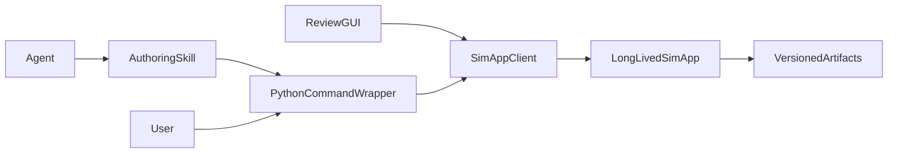

# Arena Authoring Sidecar Plan

## T1–T5 reference

<table>
  <thead>
    <tr>
      <th>ID: capability</th>
      <th>Use case</th>
      <th>API/CLI the agent calls</th>
      <th>Existing and extended <code>gui_runner</code>/SimApp sidecar features</th>
    </tr>
  </thead>
  <tbody>
    <tr>
      <td><strong>T1: Asset-physics inspection and bounded probes</strong></td>
      <td>
        <ul>
          <li>Workbench construction inspects the socket-set, case, drawer, and tool USDs to find collider ownership, occupied empty space, bridged openings, and disconnected inserts.</li>
          <li>Thor construction probes the spawned tray/carton scene to measure contact forces and verify the support-height correction.</li>
        </ul>
      </td>
      <td>
        <ul>
          <li><code>python isaaclab_arena/scripts/arena_author.py asset inspect --usd ...</code></li>
          <li><code>... asset probe --env-spec ...</code></li>
          <li>Typed <code>SimAppClient.inspect_asset()</code> and <code>probe_asset()</code> requests.</li>
        </ul>
      </td>
      <td>
        <ul>
          <li>Existing: USD resolution, asset thumbnails, AABB dimensions, axis overlays, and long-lived Kit process.</li>
          <li>Extend: physics/body/joint/collider reports, effective-value probes, contact/wrench traces, and diagnostic overlays.</li>
        </ul>
      </td>
    </tr>
    <tr>
      <td><strong>T2: Reusable force operator and demonstration runner</strong></td>
      <td>
        <ul>
          <li>Workbench construction opens drawers and the case lid, extracts cluttered tools, keeps bins upright, and withdraws the plug using forces and joint efforts.</li>
          <li>Thor construction packs all accessories from solver-generated poses without teleporting them.</li>
        </ul>
      </td>
      <td>
        <ul>
          <li><code>... force run --env-spec ... --commands ...</code></li>
          <li><code>... force serve --env-spec ...</code>, followed by session-scoped command requests.</li>
          <li>Typed <code>SimAppClient</code> force-session methods keyed by session and command IDs.</li>
        </ul>
      </td>
      <td>
        <ul>
          <li>Existing: supervised SimApp lifecycle, sequential requests, environment build/teardown, and bounded simulation preview.</li>
          <li>Extend: stateful force sessions, JSONL commands, supported <code>env.step()</code> execution, acknowledgements, limits, cleanup, and force/contact traces.</li>
        </ul>
      </td>
    </tr>
    <tr>
      <td><strong>T3: Scene preflight and reset-layout validation</strong></td>
      <td>
        <ul>
          <li>Workbench construction validates table/rack support, edge margins, drawer references, and settled <code>clutter_on</code> layouts.</li>
          <li>Thor construction verifies distinct sampled layouts remain valid after gravity and identifies unnecessary fixed poses or anchors.</li>
        </ul>
      </td>
      <td>
        <ul>
          <li><code>... scene check --env-spec ... --config ...</code></li>
          <li>Typed <code>SimAppClient.check_scene()</code> request returning per-layout results and artifact paths.</li>
        </ul>
      </td>
      <td>
        <ul>
          <li>Existing: graph-spec loading, relation-solver preview, zero-action stepping, placement collection/JSONL recording, pool validation, viewport MP4, and object-reference rendering.</li>
          <li>Refactor/share: maintained graph build/step and offline-placement workflow functions used by <code>cli_runner.py</code>, existing placement scripts, and the sidecar.</li>
          <li>Extend: static/no-pool handling, pose-distinctness checks, structured relation measurements, accepted-layout manifests, and failure snapshots.</li>
        </ul>
      </td>
    </tr>
    <tr>
      <td><strong>T4: Task contract checks and containment semantics</strong></td>
      <td>
        <ul>
          <li>Workbench construction verifies actual tool containment and that the articulated socket case is closed inside the drawer.</li>
          <li>Thor construction checks initial, wrong-compartment, prepacked, complete, remove, replace, and reset scenarios without advancing progress through diagnostics.</li>
        </ul>
      </td>
      <td>
        <ul>
          <li><code>... task check --env-spec ... --config ...</code></li>
          <li>Typed <code>SimAppClient.check_task()</code> job request and result retrieval.</li>
        </ul>
      </td>
      <td>
        <ul>
          <li>Existing: built-environment preview and sequential sidecar execution.</li>
          <li>Extend: isolated scenario jobs, cached read-only progress diagnostics, activation-aware checks, selectable containment geometry, event traces, and reset cleanup.</li>
        </ul>
      </td>
    </tr>
    <tr>
      <td><strong>T5: Evidence capture, camera fitting, and publication inputs</strong></td>
      <td>
        <ul>
          <li>Workbench construction captures the 26 subtask boundaries and links each image to the corresponding action and task state.</li>
          <li>Thor construction records six packing steps and final success while refitting the camera so randomized layouts and the tray stay visible.</li>
        </ul>
      </td>
      <td>
        <ul>
          <li><code>... force run ... --capture capture.yaml</code></li>
          <li><code>... evidence capture --env-spec ... --config ...</code> for capture-only requests.</li>
          <li>Typed capture options on sidecar jobs and <code>SimAppClient.capture_evidence()</code>.</li>
        </ul>
      </td>
      <td>
        <ul>
          <li>Existing: thumbnail and panorama capture, viewport access, preview MP4 recording, and GUI artifact display.</li>
          <li>Extend: object-aware camera fit, pre-autoreset boundary capture, event-to-frame mapping, effective camera metadata, final hold, and manifest entries. Existing host utilities perform encoding/publication.</li>
        </ul>
      </td>
    </tr>
  </tbody>
</table>

## Architecture and boundaries

- Treat the sidecar as the long-lived Kit/physics runtime for the T1–T5 capabilities above. Keep media encoding and report assembly outside SimulationApp by reusing existing host utilities; adding new host-side authoring tools is out of scope.
- Keep simulation-dependent implementation in sidecar command handlers. The wrapper sends one request through `SimAppClient`, waits for one response, prints it, and exits; the Streamlit GUI continues using `SimAppClient` directly.
- Let agents invoke [`isaaclab_arena/scripts/arena_author.py`](isaaclab_arena/scripts/arena_author.py) through an updated [`author-environment` skill](skills/developer/author-environment/SKILL.md). Every command emits one machine-readable JSON summary on stdout, detailed artifacts under `--output`, and logs on stderr or in `runtime.log`.
- Preserve sequential/single-flight SimulationApp execution initially. Use explicit jobs for long operations instead of adding unsafe parallel Kit access.
- Keep purpose-specific entry points rather than folding everything into one parser: [`cli_runner.py`](isaaclab_arena_examples/agentic_environment_generation/cli_runner.py) remains the prompt/schema/catalog/generate workflow, placement scripts remain user-facing compatibility commands, and `arena_author.py` remains the agent-to-sidecar wrapper. They share maintained Python operations instead of invoking one another as subprocesses.

## Reusable-operation boundaries

- Move graph-environment build and zero-action execution out of the example runners into maintained functions under [`isaaclab_arena/agentic_environment_generation/simapp/`](isaaclab_arena/agentic_environment_generation/simapp/). Both the promoted sidecar preview handler and `cli_runner.py --mode build/full` call these functions while retaining their current SimulationApp owner.
- Complete the existing library split in [`isaaclab_arena/offline_placement/recording.py`](isaaclab_arena/offline_placement/recording.py): it owns environment-independent collection, settle/validation, recording, and structured summaries. Add a maintained placement-workflow function for graph-spec loading, builder configuration, sampling, and guaranteed environment closure.
- Reduce [`record_placement_layouts.py`](isaaclab_arena/scripts/record_placement_layouts.py) to Hydra/AppLauncher argument handling plus human-readable summary formatting. Preserve its command and configuration behavior as a compatibility adapter.
- Keep [`pool_validation.py`](isaaclab_arena/offline_placement/pool_validation.py) as the implementation for validating existing pool candidates, and reduce [`run_placement_pool_validation.py`](isaaclab_arena/scripts/run_placement_pool_validation.py) to environment selection and result presentation.
- Have the T3 sidecar handler call the same placement recording and pool-validation operations. Add only sidecar-specific orchestration for artifact directories, snapshots, cancellation, and the static/no-pool branch; do not duplicate reset, settling, acceptance, or JSONL-writing loops.
- Enforce one-way dependencies: example runners, scripts, sidecar handlers, and the GUI may import maintained authoring/offline-placement operations; maintained packages must not import from `isaaclab_arena_examples` or script entry points.

## Milestone 1: Promote and harden the existing sidecar

- Move reusable modules from [`isaaclab_arena_examples/agentic_environment_generation/review_gui/simapp/`](isaaclab_arena_examples/agentic_environment_generation/review_gui/simapp/) into a maintained [`isaaclab_arena/agentic_environment_generation/simapp/`](isaaclab_arena/agentic_environment_generation/simapp/) package: process supervision, server/client, preview engine, thumbnail capture, viewport capture, USD resolution, and axis overlays.
- Keep [`gui_runner.py`](isaaclab_arena_examples/agentic_environment_generation/gui_runner.py), Streamlit connectors, panels, and presentation code in `isaaclab_arena_examples`; update them to use the promoted `SimAppClient` directly. Move `object_set_member_key` out of GUI presentation code to remove the reverse dependency.
- Extract the duplicated graph-spec conversion, `ArenaEnvBuilder` setup, zero-action stepping, and environment cleanup from [`cli_runner.py`](isaaclab_arena_examples/agentic_environment_generation/cli_runner.py) and [`sim_preview.py`](isaaclab_arena_examples/agentic_environment_generation/review_gui/simapp/sim_preview.py) into maintained runtime functions. Keep preview-only video/cache naming and CLI-only console formatting in their adapters.
- Add Pydantic protocol models with `protocol_version`, `request_id`, command-specific request/response types, stable error codes, capability discovery, request-size limits, bounded parameters, and output-directory validation. Log tracebacks to `runtime.log`; keep stdout limited to the documented result schema.
- Add a supervised job API (`submit`, `status`, `result`, `cancel`) for previews, probes, scene checks, force runs, and task checks. Keep `ping` and `shutdown` internal lifecycle operations.
- Preserve the current deferred Kit imports and per-request environment teardown in [`sim_preview.py`](isaaclab_arena_examples/agentic_environment_generation/review_gui/simapp/sim_preview.py).

## Milestone 2: Add the one-command Python wrapper

- Add [`isaaclab_arena/scripts/arena_author.py`](isaaclab_arena/scripts/arena_author.py) with `sim serve`, `sim status`, `sim stop`, `graph snapshot`, and `graph preview` commands. Do not add a console entry point to [`pyproject.toml`](pyproject.toml); invoke it as `python isaaclab_arena/scripts/arena_author.py ...`.
- Implement each simulation command as one synchronous `SimAppClient` request followed by disconnect. One-shot commands may start and stop a sidecar; agents can keep `sim serve` running to amortize Kit startup.
- Update [`skills/developer/author-environment/SKILL.md`](skills/developer/author-environment/SKILL.md) with the exact script invocation, command selection, supported runtime/container discovery, long-lived sidecar lifecycle, artifact inspection, exit-code handling, and cleanup.
- Preserve the existing behavior: `render_spec` produces asset, panorama, and object-reference PNGs plus AABB dimensions; `run_sim_preview` produces a bounded zero-action viewport MP4.
- Introduce the shared `arena.authoring.v1` report envelope and incremental artifact manifest specified in [`docs/arena_authoring_tools_proposal.md`](docs/arena_authoring_tools_proposal.md): inputs, effective configuration, status, checks, timings, hashes, runtime logs, and explicit incomplete/unsupported results.

## Milestone 3: Add T1, T3, and T5 inspection/validation primitives

- T1: extract a read-only structured inspector from [`prepare_simready_asset()`](isaaclab_arena/assets/simready_asset_preparation.py), [`SpawnCfgGeometry`](isaaclab_arena/assets/spawn_cfg_geometry.py), and the USD helpers under [`isaaclab_arena/utils/usd/`](isaaclab_arena/utils/usd/). Report rigid/articulation ownership, joints, collider provenance, units, bounds, mass/inertia, and unsupported cooked geometry without mutating source USDs.
- Add bounded runtime probes that load assets/scenes through the sidecar and emit displacement, contacts, wrenches, effective physics values, and collision/joint/contact overlay PNGs. Generalize the Thor fit checker and workbench adapters as fixtures, not production special cases.
- T3: build `scene check` from `ArenaEnvGraphSpec`, `ArenaEnvBuilder`, [`validate_pool_layouts()`](isaaclab_arena/offline_placement/pool_validation.py), and the maintained recording workflow extracted from [`record_placement_layouts.py`](isaaclab_arena/scripts/record_placement_layouts.py). Add static/no-pool handling and structured per-relation measurements while retaining existing boolean consumers and Rerun output.
- Move `record_placements_to_jsonl()` and `record_settled_placement_layouts()` into maintained offline-placement modules before integrating T3. The legacy recording script and T3 handler both call those functions; T3 selects sampled-recording, existing-pool validation, or static-current-layout mode explicitly and reports which path ran.
- T5: generalize viewport capture into explicit camera fitting, snapshot, and boundary-capture services. Record camera transform/intrinsics and frame/event mappings; capture terminating frames before autoreset. Keep FFmpeg GIF/gallery/report publication outside SimulationApp, reusing [`build_report()`](isaaclab_arena/visualization/report.py).
- Expose `asset inspect`, `asset probe`, `scene check`, and `evidence capture` as Python wrapper subcommands.

## Milestone 4: Add T2 and T4 stateful execution

- Extract the bounded force/joint controller and JSONL command model from the workbench and Thor demos into `isaaclab_arena/authoring/force/`. Support `move`, `joint_effort_to`, `release`, `release_all`, `wait`, `inspect`, `assert`, and `finish` with IDs, acknowledgements, timeouts, limits, and traces.
- Implement finite `force run` as a job and interactive `force serve` as a stateful sidecar session. Use the supported `env.step()`/recorder/progress lifecycle; distinguish reset/setup writes from physical commands and never report teleportation as force success.
- Add a read-only cached diagnostic snapshot to `ProgressTracker`, optional `require_entry_after_activation` to `ObjectInTask`, and selectable containment geometry while preserving defaults.
- Build `task check` as isolated scenario jobs for initial, wrong-target, prepacked, complete, remove, replace, and reset cases. Diagnostics must not re-evaluate or mutate stateful predicates.
- Expose `force run`, session-scoped `force command`/`force finish`, and `task check` subcommands, with one owner and explicit session cleanup.

## Validation and rollout

- Move pure protocol, USD-resolution, and overlay tests into [`isaaclab_arena/tests/`](isaaclab_arena/tests/). Extend [`isaaclab_arena_examples/tests/test_review_gui.py`](isaaclab_arena_examples/tests/test_review_gui.py) for compatibility adapters during migration.
- Add unit tests for every request/response model, invalid/oversized requests, path traversal/symlink escapes, capability discovery, stable errors, cancellation, and partial manifests.
- Add wrapper contract tests for JSON stdout, stderr isolation, documented exit codes, automatic and persistent sidecar modes, and direct script invocation from the authoring skill.
- Add subprocess tests for snapshot rendering, cache hit/miss, panorama, preview MP4, repeated requests after teardown, and clean shutdown. Keep SimulationApp subprocess tests separate from persistent-app phases.
- Add adapter-parity tests: `cli_runner.py --mode build` and graph preview use the same maintained build/step primitives; the legacy placement-recording command and T3 sampled-recording mode produce equivalent accepted-layout JSONL and rejection summaries for the same seed/config; pool-validation output is derived from the same structured results.
- Add end-to-end acceptance fixtures from the workbench and Thor environments: collider ownership and contact probe (T1), physical command completion (T2), distinct settled layouts and structured failures (T3), negative task scenarios without diagnostic side effects (T4), and correctly timed media and bounded GIFs (T5).
- Deliver each milestone as a reviewable PR. Keep the old GUI import paths working only through explicit adapter modules during migration, then remove them after the GUI and documentation use the maintained core paths.
