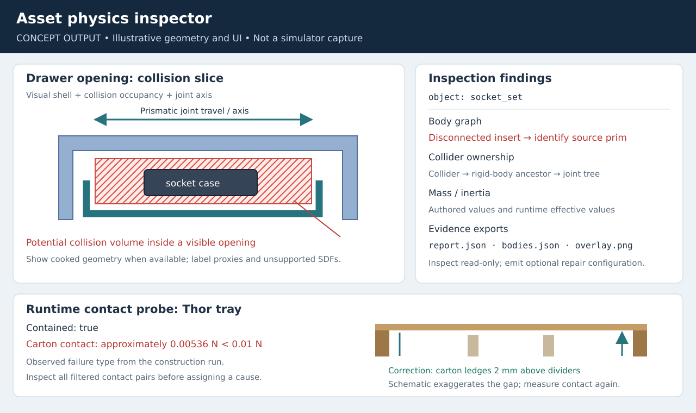
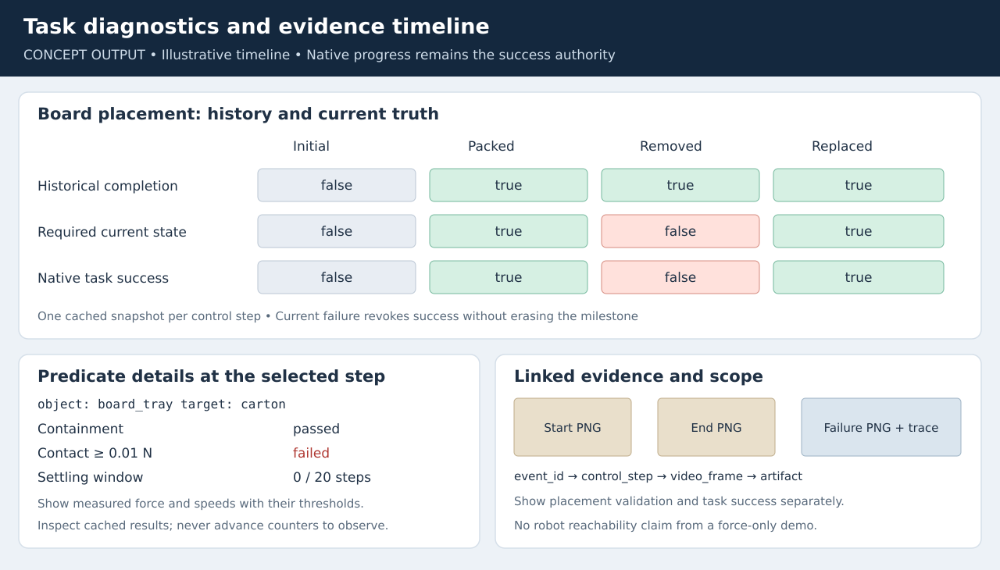

# Arena authoring and validation tools proposal

Prioritize **asset-physics inspection and reusable force validation**, then expose
scene preflight and evidence publication through the same reporting contract.
In the workbench construction report, physics/control debugging and packing/final-state
checks occupied approximately 75% of construction time. This suggests where to start;
it does not establish a measured speedup for any proposed tool.

This proposal consolidates the additions identified in the
[workbench construction report](../isaaclab_arena_environments/workbench_cleanup/CONSTRUCTION_AND_VALIDATION.md#arena-additions-that-could-speed-up-similar-work)
and [Jetson packing report](../isaaclab_arena_environments/jetson_thor_packing/README.md#process-notes).
The source audit was performed on October 27, 2026, including the working-tree
changes that use solved `on(tabletop)` placements for the Jetson scene.

**Every `arena-author` command, configuration extension, and output schema below is
proposed. There is no implemented `arena-author` entry point in this checkout.**
Existing commands are explicitly labeled. This change supplies a design document
and concept illustrations, not implementations or new simulation results.

## Tool inventory and delivery order

| ID | Proposed command family | Concrete use case | Existing coverage | Required work / relative scope |
| --- | --- | --- | --- | --- |
| [T1](#t1-asset-physics-inspection-and-bounded-probes) | `arena-author asset inspect` / `asset probe` | Find blocked drawer space, disconnected case inserts, and the Jetson tray's weak carton contact | USD preparation, geometry extraction, contact sensors, local diagnostics | Expose a structured inspector; add collision overlays and measured probes. Medium; collider adapters are a later extension. |
| [T2](#t2-reusable-force-operator-and-demonstration-runner) | `arena-author force run` / `force serve` | Complete all three workbench tasks and pack the Thor kit from solved poses | Two working environment-specific demos; interactive environment runner | Extract controllers and add a supported stepping/recording lifecycle. Medium–large. |
| [T3](#t3-scene-preflight-and-reset-layout-validation) | `arena-author scene check` | Diagnose support height/edge margins and validate several solved reset layouts | Placement solver, pool validation, post-physics validators, Rerun views, layout recording | Mostly CLI/report integration; richer per-relation diagnostics need API changes. Small–medium. |
| [T4](#t4-task-contract-checks-and-reusable-containment-semantics) | `arena-author task check` | Reject wrong compartments, prepacked boards, perched tools, and stale final success | Native progress, temporal predicates, local task extensions | Scenario runner plus optional stock containment/new-entry support. Medium–large. |
| [T5](#t5-evidence-capture-camera-fitting-and-publication) | `arena-author evidence publish` and capture options on T2/T4 | Save each subtask boundary, native success, captions, GIFs, and a review gallery | Episode recording, video wrappers, HTML reports, local publisher | Capture lifecycle, boundary mapping, camera fitting, and media export. Medium. |
| [T6](#t6-capability-oriented-simready-search-and-public-cache-access) | `arena-author asset search` / `asset fetch` | Discover a movable bin instead of fused blue bins; inspect drawer/button/plug capability | SimReady search backends and cached preparation | Public fetch-only API and evidence-backed capability filters. Medium. |
| [T7](#t7-blender-mcp-preflight-and-parameterized-asset-build) | `arena-author blender check` / `blender build` | Build fitted multilayer Thor packaging and accessories through Blender MCP | Working task-specific MCP bridge, geometry generator, USD wrappers, fit checker | Parameterized build recipes, exporter capability discovery, and asset manifest. Medium–large. |

Implement T1/T2 first, reuse T3's existing validation during their development,
and share T4/T5's event/report contract from the start. T6 consumes T1's inspection
results; T7 should reuse T1 and T3 rather than introduce another physics validator.
A small manifest utility, specified below, belongs to all seven tools.

## Shared CLI and data contract

Use a thin dispatcher over maintained Python APIs. Keep implementation under the
existing asset, relation, task, recording, and visualization packages where possible;
the dispatcher should handle arguments and serialize results, not implement a second
solver, progress tracker, recorder, or physics engine.

- File inputs: YAML configuration, USD entry points, existing Arena graph YAML,
  JSONL command streams, and PNG/JPEG references. Relative paths in a configuration
  resolve against that file's directory; CLI paths resolve against the working directory.
- Common flags: `--config`, `--output`, `--format json|text`, and `--overwrite`.
  Scene execution also accepts `--env-spec`, `--device`, `--visualizer`, and
  `--placement-seed`. These proposed spellings may adapt Arena's existing underscore
  flags; they do not silently rename fields in existing graph YAML.
- `--output` names an artifact directory containing `manifest.json`, `report.json`,
  and optional `events.jsonl`, `episode_results.jsonl`, `layouts.jsonl`, `images/`,
  `demo.mp4`, `demo.gif`, and `index.html`. Do not overwrite an existing run by default.
- JSON stdout is one machine-readable summary; progress and simulator logs go to
  stderr or `runtime.log`. Redirect child-process output so Kit cannot corrupt JSON.
  Live operator responses use one JSON object per line instead.
- Exit `0`: all requested operations and required checks passed. Exit `1`: completed
  inspection/validation found a failed required check. Exit `2`: invalid input,
  missing dependency, unsupported backend, or incomplete execution. Preserve partial
  reports with `status: incomplete`; never turn a skipped check into a passing check.
- SI units: metres, seconds, kilograms, newtons, newton-metres, and radians. USD
  inspection records authored units and conversion to SI. Prismatic joint targets
  use metres; revolute targets use radians. Quaternions are explicitly `xyzw`.
- Poses identify their frames: `T_W_O` maps object O into world W; `T_C_O` maps O
  into carton C. A multi-environment layout uses environment frame E and records
  the environment origin. Store exact sampled poses and layout identifiers as well
  as the seed; pool consumption and software changes can alter the sequence.
- Placement checks, physics settlement, task success, and robot reachability are
  separate verdicts. A force demo with `NoEmbodiment` demonstrates physical task
  completion, not a robot policy or grasp/reachability solution.

Illustrative report envelope; tool-specific fields go under `data`:

```json
{
  "schema_version": "arena.authoring.v1",
  "tool": "scene.check",
  "run_id": "thor-layouts-001",
  "status": "passed",
  "checks": [
    {"name": "on_relation", "status": "passed", "required": true, "evidence": "layouts.jsonl"},
    {"name": "ik_reachable", "status": "skipped", "required": false, "reason": "NoEmbodiment"}
  ],
  "data": {"layouts_checked": 3},
  "artifacts": [{"path": "images/layout_000.png", "media_type": "image/png"}]
}
```

Simulation commands run in this clone's container as the host user, using the
launcher described by the [dev-container skill](../skills/developer/dev-container/SKILL.md).
Do not hardcode the container name. A future USD-only inspector can run without
SimulationApp only after its imports are separated from Isaac Lab/Kit. Blender MCP
runs in host Python; offline media publication needs FFmpeg, not simulation.
Initial runtime-probe/force support should explicitly target CPU PhysX, matching
the validated examples. Report other backend support per operation rather than
assuming the custom force controller works with Newton.

## T1. Asset-physics inspection and bounded probes

**Needed for:** the workbench's source SDF occupied apparently empty drawer space;
an attempted whole-mesh convex replacement bridged openings; socket-set inserts
were disconnected; light tools were pinned by heavier ones. In the Thor task,
containment passed while the intended carton contact was too weak because divider
tops were flush with its support ledges. A topology report alone cannot diagnose
all of these; inspect authored geometry first and measure the spawned scene next.

Proposed CLI:

```bash
arena-author asset inspect --usd assets/socket_set.usda --config inspect.yaml \
  --output artifacts/inspect_socket_set
arena-author asset probe \
  --env-spec isaaclab_arena_environments/jetson_thor_packing/task.yaml \
  --config tray_probe.yaml --device cpu --visualizer kit \
  --output artifacts/tray_probe
```

Input examples (`inspect.yaml`, then `tray_probe.yaml`):

```yaml
schema_version: arena.asset-inspection.v1
variants: {Physics: physics, PhysX: Enabled}
checks: [composition, units, body_joint_graph, collider_ownership, collision_geometry, mass_inertia]
views: [visual_and_collision, joint_axes, body_graph]
```

```yaml
schema_version: arena.asset-probe.v1
prepare_commands: pack_through_tray.jsonl
object: board_tray
contact_targets: [carton, ac_bay, usb_bay, power_bay]
release_before_measurement: true
measure_seconds: 1.0
required_contacts: [{target: carton, minimum_force_n: 0.01}]
```

`prepare_commands` uses T2's force protocol. Other probe recipes may apply a bounded
wrench or joint effort for a specified duration, recording limits, displacement,
joint position, velocity, contact pair, and residual pose error. They must distinguish
an authored mass/inertia from the effective values computed after physics import.

**Output:** `report.json` contains body/parent paths, enabled/kinematic flags,
joint endpoints/type/axis/limits/drives, per-collider ownership and approximation,
units, bounds, unresolved dependencies, and observations with explicit provenance.
Runtime probes add `contacts.jsonl`, `wrenches.jsonl`, effective mass/inertia, and
overlay PNGs. An SDF or cooked collider that cannot be decoded must be marked
unsupported; rendering the source mesh is not proof of the cooked contact volume.

Illustrative diagnostic based on the observed Thor failure, not a new measurement:

```json
{
  "object": "board_tray",
  "target": "carton",
  "contained": true,
  "filtered_contact_force_norm_n": 0.00536,
  "required_contact_force_n": 0.01,
  "status": "failed",
  "suspected_cause": "Other receptacles may support the tray; inspect their contact pairs."
}
```

**Existing code to expose:**

| Source | Reuse | Modification needed |
| --- | --- | --- |
| [`prepare_simready_asset()`](../isaaclab_arena/assets/simready_asset_preparation.py) | Variant selection and rigid/articulated topology validation | Separate a read-only inspector from wrapper creation; return findings for every invalid node rather than stopping at the first assertion. Its private classifier rejects some topology, including world-connected joints; inspection must still describe such assets. |
| [`SpawnCfgGeometry`](../isaaclab_arena/assets/spawn_cfg_geometry.py), [USD rigid-body helpers](../isaaclab_arena/utils/usd/rigid_bodies.py), [USD geometry helpers](../isaaclab_arena/utils/usd/helpers.py) | Variant-aware bounds, rigid ownership, collision meshes, posed-link geometry | Return units/scale/variant provenance and structured unsupported-geometry reasons. Avoid promising simulation-free execution for the current Isaac Lab-dependent import path. |
| [`UsdPrimSpawnPhysicsCfg`](../isaaclab_arena/assets/physics_config.py) and [`physics_spawner.py`](../isaaclab_arena/assets/physics_spawner.py) | Validated per-prim physics overrides before cloning/import | Add reusable panel-container and articulated-insert adapters with explicit configuration; inspection should emit an optional patch, not modify source assets automatically. |
| [Workbench asset adapters](../isaaclab_arena_environments/workbench_cleanup/assets.py), [Thor fit checker](../isaaclab_arena_environments/jetson_thor_packing/validate_geometry.py) | Proven open-tray panels, case insert fixes, and upright collider-AABB clearance checks | Remove hardcoded paths and dimensions. Preserve the fit checker's scope: nonintersecting upright panel AABBs are not a general mesh or dynamic-contact proof. |

**Visual output required:** selectable visual/collision layers, body and joint
labels, and contact arrows with pair names and force units. This illustration is
an expected UI concept, not an existing inspector screenshot:



Acceptance example: flag disconnected inserts without losing the rest of the
report; identify which body owns each collider; reproduce the low tray/carton
contact finding and show the measured result after the 2 mm support correction.

## T2. Reusable force operator and demonstration runner

**Needed for:** opening drawers and the case lid with effort, extracting tools from
clutter, keeping a loaded bin upright, withdrawing the plug, and packing the Thor
kit from solver-generated positions. The current demos work, but the Thor runner
inherits a workbench-specific controller and both own their simulation loops.

Proposed CLI:

```bash
arena-author force run \
  --env-spec isaaclab_arena_environments/jetson_thor_packing/task.yaml \
  --commands pack_thor.jsonl --config force.yaml --placement-seed 17 --episodes 3 \
  --device cpu --visualizer none --output artifacts/thor_force
arena-author force serve \
  --env-spec isaaclab_arena_environments/workbench_cleanup/task_1.yaml \
  --commands live.jsonl --device cpu --visualizer kit --output artifacts/workbench_operator
```

`run` consumes a finite stream and treats missing final assertions as incomplete.
`serve` accepts append-only JSONL; each command has an ID and receives an acknowledgement
and terminal result. Paused/idle behavior must be explicit, since live physics can
change a scene while an operator is deciding the next action.

Input configuration and a **partial** packing command stream:

```yaml
schema_version: arena.force.v1
controller:
  translation_stiffness_n_per_m: 60.0
  translation_damping_n_s_per_m: 8.0
  max_force_n: 100.0
  max_torque_nm: 5.0
  gravity_compensation: true
orientation_policy: hold_command_start
completion: {release_all: true, settle_seconds: 1.0, require_native_success: true}
```

```jsonl
{"id":"lift-us","action":"move","object":"ac_cable_us","goal":{"reference":"carton","keep_current_xy":true,"z_m":0.26},"duration_s":1.4}
{"id":"above-us","action":"move","object":"ac_cable_us","goal":{"reference":"carton","position_xyz":[-0.144,0,0.26],"rotation_xyzw":[0,0,0,1]},"duration_s":1.8}
{"id":"seat-us","action":"move","object":"ac_cable_us","goal":{"reference":"carton","position_xyz":[-0.144,0,0.008],"rotation_xyzw":[0,0,0,1]},"duration_s":2.2}
{"id":"release-us","action":"release","object":"ac_cable_us"}
{"id":"check-us","action":"assert","subtask_index":0,"expected_current":true,"timeout_s":3.0}
```

Resolve `reference` through live scene/link poses. `keep_current_xy` preserves the
object's coordinates in that reference frame, not old hardcoded world coordinates.
Support `move`, `joint_effort_to`, `release`, `release_all`, `wait`, `inspect`,
`assert`, and `finish`; distinguish joint position goals from effort limits.
PD gains above illustrate the configuration format, not a universal controller
tuning. Allow per-object profiles instead of special cases on asset names.

**Output:** command-result JSONL, sampled starting poses, applied wrench/effort and
contact traces, per-command timeout/failure reason, native subtask/current-success
state, active holds, and T5's optional boundary media. Movements must use forces
and joint efforts; setup/reset state writes must be separately labeled. State
teleportation cannot masquerade as a successful force demonstration.

Example response for the partial stream above:

```json
{
  "command_id": "check-us",
  "status": "completed",
  "subtask_index": 0,
  "historical_complete": true,
  "required_current_state_met": true,
  "native_task_success": false,
  "active_root_holds": [],
  "active_joint_holds": []
}
```

Completing one subtask does not imply completion of the entire packing task.

**Existing code to expose:**

- [`ForceDemo`](../isaaclab_arena_environments/workbench_cleanup/force_demo.py) already
  has `move`, `lift`, `joint`, `release`, JSONL operator commands, bounded PD wrenches,
  and progress checks. Extract these into a maintained controller and command adapter.
  Remove workbench names, fixed cameras, cable/display effects, and gain special cases.
- [`ThorPackingDemo`](../isaaclab_arena_environments/jetson_thor_packing/force_demo.py)
  already uses actual starting positions, carton-relative goals, multiple reset
  layouts, placement checklists, and negative checks. Convert its sequence into a
  recipe and retain it as a migration/regression example.
- [`environment_runner.py`](../isaaclab_arena/scripts/environment_runner.py) is an
  **existing interactive** CPU-PhysX, one-environment, Kit-only runner with Shift-drag
  D6 manipulation. It disables recorders and uses normal `env.step()` with reset
  behavior. It does not currently provide a headless force-command mode. Share its
  environment loading/interaction setup, but add a separate bounded executor or an
  explicit mode with validated lifecycle behavior.
- [`ArenaWorld`](../isaaclab_arena/environments/arena_world.py) supplies live root/link
  poses and velocities. Continue using Isaac Lab's wrench composer and joint effort
  targets. Put progress, sensors, recorder callbacks, final-state capture, and
  reset suppression in one supported step path. Copying the demo's direct physics
  loop would otherwise bypass the normal recording lifecycle.

Acceptance: all six Thor subtasks pass across the three documented solved layouts,
and all three workbench tasks complete with current final conditions satisfied.
Check wrench and joint-hold release separately; an empty root-hold list alone is
insufficient. Trace all timeouts. Unspecified yaw robustness is not implied by the
upright-layout tests.

**Visual reference:** the current successful force video provides the expected
scene/action output; live overlays and automated capture are additions:
[Thor demo](images/jetson_thor_packing/packing_demo.mp4),
[workbench demonstrations](images/workbench_cleanup/workbench_cleanup_demo.gif).

## T3. Scene preflight and reset-layout validation

**Needed for:** tabletop support height, rack edge margins, articulated drawer
references, `clutter_on` drops, and removal of unnecessary anchors/fixed poses in
the Thor scene. A scene that parses can still fail placement or become unstable
after gravity acts.

Proposed CLI:

```bash
arena-author scene check \
  --env-spec isaaclab_arena_environments/jetson_thor_packing/task.yaml \
  --config scene_check.yaml --device cpu --visualizer none \
  --output artifacts/thor_preflight
```

Input configuration:

```yaml
schema_version: arena.scene-check.v1
stages: [schema, references, placement, post_physics]
sampling: {placement_seed: 17, distinct_layouts: 3, max_resets: 10}
placement: {require_checks: [on_relation, no_overlap], allow_best_loss_fallbacks: false}
settle: {control_steps: 120, linear_speed_m_per_s: 0.015, angular_speed_rad_per_s: 0.1}
exports: {accepted_layouts: true, rerun: true, snapshots: true}
```

The wrapper maps this configuration into existing `ObjectPlacerParams` and
post-physics validators; it records all effective overrides. Handle static scenes
without pools as one current layout, with sampling marked inapplicable. Different
reset counters are not proof of different layouts: compare recorded poses. Validate
clutter with the existing clutter validators after settling; do not require a
cluttered stack to satisfy the same no-overlap criterion as an unstacked release layout.

**Output:** per-layout JSON verdicts, existing placement-replay JSONL, optional
`placement.rrd`, and failed/accepted snapshots. Diagnostics identify the relation,
subject/reference, measured support gap, required clearance, edge margin, offending
pair, geometry approximation, and pre-/post-physics stage. Label unavailable
measurements instead of inferring them from a boolean result.

```json
{
  "check": "on_relation",
  "status": "failed",
  "subject": "overhead_bin",
  "reference": "top_rack",
  "reason": "footprint_margin",
  "required_margin_m": 0.05,
  "measured_min_margin_m": 0.012,
  "stage": "pre_physics"
}
```

The margin numbers illustrate the proposed format; the report does not claim they
were measured in the construction run.

**Existing code to expose:**

| Source | Already available | Modification needed |
| --- | --- | --- |
| [`ArenaEnvGraphSpec`](../isaaclab_arena/environment_spec/arena_env_graph_spec.py), [`ArenaEnvBuilder`](../isaaclab_arena/environments/arena_env_builder.py) | YAML loading/conversion, build, placement preparation | Stage-by-stage structured errors, effective-config export, static-scene handling, and hints for redundant anchors. |
| [`run_placement_pool_validation.py`](../isaaclab_arena/scripts/run_placement_pool_validation.py), [`validate_pool_layouts()`](../isaaclab_arena/offline_placement/pool_validation.py) | Iterate stored layouts, step physics, stamp settled verdicts | JSON output and failure exit status; its existing CLI primarily prints results. Add a no-pool branch rather than claiming the current sweep handles static/replayed scenes. |
| [`record_settled_placement_layouts()`](../isaaclab_arena/scripts/record_placement_layouts.py), [post-physics validators](../isaaclab_arena/offline_placement/post_physics_validation.py), [clutter validators](../isaaclab_arena/offline_placement/clutter_validators.py) | Configurable post-physics validation, accepted layout JSONL, rejection accounting | Reuse recording schema. Surface incomplete sample budgets as non-success; preserve articulation skip reasons and distinguish final velocity from broader stability. |
| [Pre-physics validators](../isaaclab_arena/relations/validation/pre_physics.py), [`PlacementValidationResults` / `PlacementValidatorReport`](../isaaclab_arena/relations/validation/types.py) | Boolean solver checks; post-physics reports already carry configuration and reasons | Add optional structured per-object/pair measurements to existing reports while preserving boolean consumers. Check explicitly for missing required checks. |
| [`PlacementRerunVisualizer`](../isaaclab_arena/relations/placement_visualizer.py) | Object/anchor views, validator layers and verdicts, `.rrd` output | Reuse this viewer; add dimension annotations, export links, and offline snapshot output where needed. Do not build a second placement visualizer. |
| [`ObjectReference`](../isaaclab_arena/assets/object_reference.py), [`ArenaWorld` scene access](../isaaclab_arena/environments/arena_world_scene_access.py) | Source-prim references and live scene-extra pose readers | Preflight source-to-runtime paths, contact reporter availability, moving-link access, and unsupported transforms. Reference placement stays fixed; live task queries must follow the drawer link. |

**Existing command today**, inside the supported runtime:

```bash
./submodules/IsaacLab/isaaclab.sh -p isaaclab_arena/scripts/run_placement_pool_validation.py \
  --env_spec isaaclab_arena_environments/jetson_thor_packing/task.yaml \
  --device cpu --visualizer none --num_envs 1 --settle_steps 120 \
  --lin_vel_thresh 0.015 --ang_vel_thresh 0.1
```

Existing graph options `placer_params.debug_visualize` and
`placer_params.debug_visualize_output_path` enable the Rerun placement view/recording.
They are separate from Kit viewport snapshots and do not establish task completion.

**Visual reference:** this is an actual solved initial Thor layout. The proposed
preflight should pair such a snapshot with its layout ID and relation verdicts:


Acceptance: reproduce several distinct accepted layouts, save replayable poses,
and explain a failed support/margin check without reading a full simulator log.

## T4. Task contract checks and reusable containment semantics

**Needed for:** a wrench could appear inside a bin while failing containment;
transformed enclosing boxes invented empty corners around tapered tools; a closed
articulated socket case needed special handling. A prepacked Thor board must not
silently satisfy its later placement step. Historical completion must not hide a
tool or board removed from the required final state.

Proposed CLI:

```bash
arena-author task check \
  --env-spec isaaclab_arena_environments/jetson_thor_packing/task.yaml \
  --config task_checks.yaml --device cpu --visualizer none \
  --output artifacts/thor_task_checks
```

Input example; each named recipe is a T2 JSONL command stream or a registered
scenario hook, supplied by the environment author:

```yaml
schema_version: arena.task-check.v1
episodes: 3
placement_seed: 17
cases:
  - {name: initial_state, recipe: initial.jsonl, expect_success: false}
  - {name: wrong_compartment, recipe: usb_in_ac_bay.jsonl, expect_success: false}
  - name: prepacked_board
    recipe: prepacked_board.jsonl
    assert: {subtask_index: 5, historical_complete: false}
  - {name: complete, recipe: pack_thor.jsonl, expect_success: true}
  - {name: remove_board, recipe: pack_then_remove.jsonl, expect_success: false}
  - {name: replace_board, recipe: pack_remove_replace.jsonl, expect_success: true}
  - {name: reset, recipe: pack_then_reset.jsonl, expect_success: false}
```

Each case starts from a specified reset/layout and owns its prerequisites; the
runner must not assume case ordering provides them. A generic task description
does not contain enough information to invent a reliable adversarial motion.
For the prepacked-board test, record when its subtask becomes active and assert
that a new outside-to-inside sequence is required after that point. Do not directly
set progress counters to make the test pass.
Setup/reset operations belong to the scenario harness and must appear in its
event stream, separately from T2's physical motion commands.

**Output:** `report.json` includes expected/actual native success, historical subtask
completion, required current state, activation/transition steps, consecutive counts,
and decomposed measurements: containment fraction/geometry mode, target contact
force, linear/angular speed, and thresholds. `events.jsonl` and a timeline view
link a failure to its frame. Diagnostic readers must not call stateful predicates
again and accidentally advance their counters.

Example case-result excerpt:

```json
{
  "case": "remove_board",
  "status": "passed",
  "expected_native_success": false,
  "observed_native_success": false,
  "subtask_index": 5,
  "historical_complete": true,
  "required_current_state_met": false,
  "evidence": {"trace": "events.jsonl", "image": "images/remove_board.png"}
}
```

Here `passed` means the negative test behaved correctly; it does not label the
partially unpacked task successful.

**Existing code to expose and extend:**

- [`ProgressTracker`](../isaaclab_arena/progress_tracking/progress_tracker.py) already
  owns sequential activation, `desired_subtask_success_state`, predicate events,
  consecutive-step summaries, historical subtask completion, and current task success.
  [`task_success_from_progress`](../isaaclab_arena/tasks/terminations.py) is the
  authoritative success term. Add a read-only diagnostic snapshot of cached per-step
  results and component measurements; retain one evaluation per control step.
- [`ObjectInTask`](../isaaclab_arena/tasks/object_in_task.py) already combines AABB
  containment, intended-target contact, velocity limits, and a consecutive window.
  Add an optional `require_entry_after_activation` setting defaulting to false,
  following [`EnterHousingTask`](../isaaclab_arena_environments/jetson_thor_packing/tasks.py).
  Preserve current defaults and final contact/settling requirements.
- [`ToolInBinTask` and `ClosedCaseInDrawerTask`](../isaaclab_arena_environments/workbench_cleanup/tasks.py)
  demonstrate two geometry gaps. Stock `ArenaWorld.get_vertices_w()` uses transformed
  cached box corners for rigid geometry; it is not an actual hull query. Add optional
  cached collision-hull vertices and per-link live transforms for articulations.
  Reuse [posed-link USD helpers](../isaaclab_arena/utils/usd/helpers.py) for geometry
  preparation, but their link boxes are not exact collision hulls or live-state queries.
- Expose a containment geometry strategy without replacing contact/settling logic:
  existing AABB behavior, transformed hull vertices, and articulated per-link hulls.
  A convex hull tested against a target AABB still does not describe an arbitrary
  concave container interior. More general cavities need explicit interior regions
  or collision-aware checks; record which approximation actually ran.
- [Thor negative checks](../isaaclab_arena_environments/jetson_thor_packing/force_demo.py)
  are a working regression fixture. Generalize their runner and assertions, not the
  task's success logic. Report all-enabled-but-empty or skipped checks explicitly.

**Visual output required:** a timeline separating historical completion, current
conditions, native success, and contact/settling measurements. Expected concept:



Acceptance: already-packed, wrong-target, removal/replacement, and reset cases
behave as specified; observing diagnostics does not change progress. Include
partial resets across environments when promoting these APIs to core, not just the
single-environment fixtures. Keep the workbench's closed-lid requirement when
migrating articulated containment.

## T5. Evidence capture, camera fitting, and publication

**Needed for:** 26 workbench subtask-boundary images, six Thor packing steps, a final
success frame, captioned videos, and GIFs below 10 MB. Both tasks required custom
capture and packaging; the randomized Thor layout also exposed an initially clipped
tray, requiring a wider camera view.

Proposed capture/publication CLI:

```bash
arena-author force run \
  --env-spec isaaclab_arena_environments/jetson_thor_packing/task.yaml \
  --commands pack_thor.jsonl --capture capture.yaml \
  --device cpu --visualizer kit --output artifacts/thor_recording
arena-author evidence publish --input artifacts/thor_recording/manifest.json \
  --output docs/images/jetson_thor_packing --overwrite --gif-max-bytes 10000000
```

Capture configuration:

```yaml
schema_version: arena.capture.v1
camera:
  source: viewport
  framing: fit_objects
  objects: [carton, board_tray, thor_board, ac_cable_us, ac_cable_eu, usb_cable, power_supply]
  margin_fraction: 0.12
  refit: on_reset
boundaries: [subtask_activation, subtask_completion, task_success, failure]
video: {width: 1280, height: 720, fps: 20, final_hold_s: 4}
gif: {max_bytes: 10000000, width: 640, fps: 8}
gallery: true
```

Automatic task boundaries and explicitly named command/motion boundaries must
remain distinguishable. They can differ for parallel tasks or settling windows.
Capture the terminating frame before any automatic reset and preserve event-to-frame
mapping; screenshots must not add artificial video time as the local demo's extra
boundary frames currently do. Record the effective camera transform and intrinsics.

**Output:** PNG start/end/failure images, MP4, bounded-size GIF, captions, an HTML
gallery, checksums, and native episode results. Suggested media manifest entry:

```json
{
  "episode_id": "thor-000",
  "event_id": "subtask-4-complete",
  "control_step": 2640,
  "simulation_time_s": 44.0,
  "video_frame_index": 880,
  "image": "images/04_end.png",
  "historical_complete": true,
  "required_current_state_met": true
}
```

These frame values demonstrate the proposed time mapping, not the legacy demo's
extra-frame convention. Caption success only from the corresponding native result.
Preserve unsuccessful demonstrations with an accurate failure caption. If GIF
encoding exceeds the budget, reduce dimensions/fps through bounded retries and
report final settings; decode videos and verify linked files before publication.

**Existing code to expose:**

| Source | Reuse | Modification needed |
| --- | --- | --- |
| [`VideoRecordingCfg` / `wrap_env_for_video()`](../isaaclab_arena/video/video_recording.py) | Viewport and observation-camera video adapters | Connect the supported T2 step lifecycle or provide an explicit frame sink; Gym video wrappers do not see the local force demo's direct physics steps. |
| [`EpisodeRecorderManager`](../isaaclab_arena/recording/episode_recorder_manager.py), [core/placement terms](../isaaclab_arena/recording/common_terms.py), [progress terms](../isaaclab_arena/recording/progress_terms.py) | Native per-episode JSONL, sampled layouts, progress events and consecutive counts | Add boundary-image references and explicit finishing capture for force runs that suppress autoreset. Reuse existing result fields rather than invent incompatible success records. |
| [`build_report()`](../isaaclab_arena/visualization/report.py) and [report data model](../isaaclab_arena/visualization/report_data.py) | Existing HTML index/task/run/episode report | Add boundary cards and physics diagnostics, and adapt force-run identity fields to the existing job/env/episode schema. Arbitrary `validation.json` files are not automatically compatible. |
| [Workbench capture](../isaaclab_arena_environments/workbench_cleanup/force_demo.py), [Thor publisher](../isaaclab_arena_environments/jetson_thor_packing/publish_demo.py) | Viewport capture, captions, final hold, FFmpeg GIF encoding | Parameterize source/destination, remove hardcoded task paths, and share timestamping, camera fit, and export limits. |

**Existing report command today**, for an existing compatible result directory:

```bash
./submodules/IsaacLab/isaaclab.sh -p isaaclab_arena/visualization/report.py \
  --video_dir artifacts/compatible_results --title 'Authoring validation' --no_serve
```

**Actual output reference:** [workbench boundary gallery](images/workbench_cleanup/index.html)
and [Thor GIF](images/jetson_thor_packing/packing_demo.gif). These show the expected
quality of images/media, not an implemented generalized recorder.

| Tray subtask start: lower accessories already packed | Tray subtask end: board housing installed |
| --- | --- |
|  |  |

Acceptance: every requested boundary has a correctly timed image; final success
agrees with native termination; all scattered objects fit in the initial view;
media decode successfully; every requested GIF stays below the configured byte limit.

## T6. Capability-oriented SimReady search and public cache access

**Needed for:** the workbench's blue bins are fused visual geometry, while the
separate replacement bin is movable. Drawers and the socket-set lid need usable
joints; an oscilloscope button alone does not imply an electrical power circuit or
a detachable cord. These questions should be answered before full scene assembly.

Proposed CLI:

```bash
arena-author asset search --source simready-central --config bin_search.yaml \
  --output artifacts/bin_search
arena-author asset fetch --request selected_asset.yaml --output artifacts/bin_package
```

Input examples:

```yaml
schema_version: arena.asset-search.v1
query: overhead storage bin
limit: 5
requirements:
  independent_dynamic_body: true
  container_interior: true
verification: [catalogue, usd_static]
```

```yaml
schema_version: arena.asset-fetch.v1
source_url: hf://huggingface.co/datasets/PalatialSim/palatial-nv-asset-library/resolve/69a87329036cec0440403351c12230970c4e67d8/D00814/simready_usd/D00814.usd
operation: download_only
```

**Output:** ranked candidates with pinned source URL/revision, cached entry point,
package file manifest/checksums, tags, capability verdicts, evidence prims, rejection
reasons, and optional thumbnails. Capability values are `supported`, `unsupported`,
or `unknown`, accompanied by `catalogue`, `usd_static`, or `runtime_probe` provenance.
Do not equate “rigid body found” with independent pickability, or visible cavity
with usable collision interior. Clearances and robot graspability require more
information than search metadata. Device on/off and plug withdrawal are separate
capabilities from electrical simulation.

Illustrative candidate fragment:

```json
{
  "candidate": "blue_bin_component",
  "capabilities": {
    "independent_dynamic_body": {
      "status": "unsupported",
      "evidence_level": "usd_static",
      "reason": "Geometry belongs to the bench body; no separate dynamic body."
    },
    "container_interior": {"status": "unknown", "reason": "Collision interior not probed."}
  }
}
```

**Existing code to expose:**

- [`search_simready_objects()`](../isaaclab_arena/agentic_environment_generation/simready_asset_search.py)
  already merges search backends; [`SimReadySearchConfig` and candidate types](../isaaclab_arena/agentic_environment_generation/simready_search_interface.py)
  carry sources, result limits, object type, score, tags, and source URLs. Extend
  candidates with inspected capability evidence; add a search-only CLI, separate
  from environment generation.
- [`CentralSearchBackend`](../isaaclab_arena/agentic_environment_generation/simready_central_assets.py)
  already downloads and validates rigid/articulated candidates. Its raw USD
  properties are not retained as a capability report. Separate cheap discovery
  from optional inspection, preserve rejection reasons, and reuse T1 for verification.
- [`download_and_wrap_central_asset()`](../isaaclab_arena/assets/simready_central_asset_loader.py)
  is already public. Only fetch-without-wrapping remains private as
  `_download_central_asset_package_to_cache()`, which the workbench adapter used.
  Expose that narrower operation with a typed package manifest, configurable cache,
  cached-only mode, and cache-identity metadata. Continue downloading only the pinned
  asset package and dependencies, not a whole dataset.
- The [agentic CLI runner](../isaaclab_arena_examples/agentic_environment_generation/cli_runner.py)
  already accepts `--enable_simready_search`, `--simready_sources`, and
  `--simready_max_results_per_object`. It is a generation workflow, not the proposed
  standalone capability inspector. Reuse the backend configuration rather than
  add another HTTP client or search service.

**Actual visual reference:** blue rack bins versus the independent gray replacement:


The expected search UI adds a capability/evidence card beside each thumbnail. The
image alone does not prove the verdict. Acceptance: reject the fused component for
the pickable-bin requirement, keep uncertain capabilities unknown, and report the
selected replacement's source revision without private-helper calls.

## T7. Blender MCP preflight and parameterized asset build

**Needed for:** reference-image inventory, finding a responsive MCP endpoint,
Blender-version-dependent USD export arguments, accurate kit dimensions, collision
ancestry, fitted cardboard layers, and rigid coiled leads. The current Thor recipe
solves one kit but is not a general photo-to-CAD system.

Proposed CLI:

```bash
arena-author blender check --server mcp-for-blender --port 9877 \
  --references ~/Downloads/jetson --output artifacts/blender_check
arena-author blender build --server mcp-for-blender --port 9877 \
  --config thor_assets.yaml --output artifacts/thor_assets
```

Input example (proposed recipe format; dimensions are from the existing Thor build):

```yaml
schema_version: arena.blender-build.v1
recipe: multilayer_kit_carton
prompt_file: prompt.txt
references_dir: references
units: m
kit:
  size_xyz: [0.24319, 0.11240, 0.05688]
  dimension_basis: manufacturer
packaging:
  exterior_xyz: [0.360, 0.220, 0.160]
  tray_exterior_xyz: [0.342, 0.202, 0.066]
  board_well_xy: [0.257, 0.126]
  tray_underside_z: 0.082
  dimension_basis: photo_estimate
accessories:
  - {id: power_supply, primitive: adapter_with_captive_coil, rigid: true}
  - {id: ac_cable_us, primitive: coiled_lead, connector: us_ac, rigid: true}
  - {id: ac_cable_eu, primitive: coiled_lead, connector: eu_ac, rigid: true}
  - {id: usb_cable, primitive: coiled_lead, connector: usb_a_to_c, rigid: true}
physics: {housing_colliders: separate_panels, decorative_collision: false}
```

Connector shapes, accessory sizes, mass/friction, compartment layout, and export
roots come from a versioned recipe or explicit overrides; record the expanded
configuration. Missing dimensions need a recorded assumption or author input, not
an invented manufacturer measurement. References can guide construction without
being redistributed in the exported package.

**Output:** `preflight.json` with reference hashes/dimensions, MCP initialize/tool
list and bounded test-call results, Blender/addon versions, and supported exporter
properties. A successful build produces `.blend`, visual USDs, physics wrapper layers,
`assets.json` with roots/units/bounds/collider paths/masses, `dimensions.json`,
`fit_report.json`, and a labeled preview/exploded view. T1 validates each asset;
T3/T4 validate assembly in simulation. Do not automatically treat a new asset build
as evidence that the packing task remains solvable.

Example `assets.json` entry, using the existing kit's measured bounds:

```json
{
  "asset_id": "thor_board",
  "visual_usd": "thor_board.usdc",
  "physics_usd": "thor_board.physics.usda",
  "default_prim": "/Asset",
  "meters_per_unit": 1.0,
  "measured_size_xyz_m": [0.24319, 0.11240, 0.05685],
  "nominal_size_xyz_m": [0.24319, 0.11240, 0.05688],
  "collision_panel_count": 6,
  "inspection_report": "inspection/thor_board.json"
}
```

**Existing code to expose:**

- [`build_with_mcp.py`](../isaaclab_arena_environments/jetson_thor_packing/build_with_mcp.py)
  already initializes an MCP stdio client, calls `execute_blender_code`, records
  logs/results, and verifies a dimensions file. Add capability discovery, shorter
  preflight timeouts, exporter-version checks, reference inventory, and structured
  errors before a long build. A listening TCP port alone does not prove MCP/Blender
  readiness. Keep endpoint selection explicit.
- [`build_assets.py`](../isaaclab_arena_environments/jetson_thor_packing/build_assets.py)
  already contains box/panel, tube, label, coil, scene ownership, USD export, and
  preview generation. Extract these into versioned primitives and recipes, query
  Blender's supported export properties, and avoid deleting unrelated scenes.
- [`physics_asset()`](../isaaclab_arena_environments/jetson_thor_packing/assets.py)
  adds rigid bodies, convex panel colliders, contact parameters, and cached wrappers.
  Replace name/ancestor conventions such as `COL_` with an explicit collider
  manifest or tagged metadata while retaining compatibility with existing exports.
  Key caches by geometry/configuration/exporter version, not only file modification time.
- [`validate_geometry.py`](../isaaclab_arena_environments/jetson_thor_packing/validate_geometry.py)
  checks actual exported dimensions and independent panel AABBs at designed resting
  poses. Parameterize assemblies and tolerances; report measured versus nominal
  clearances. General meshes and deformation remain separate capabilities.
- Add a focused Blender-to-Arena skill for the workflow once the APIs exist; keep
  recipe defaults and export-version logic in code, not only in prompt instructions.
  Synchronize canonical skill sources and discovery aliases as required by the repo.

**Actual visual reference:** existing Blender construction preview. The proposed
tool should also emit a dimensioned exploded view identifying the removable tray,
lower compartments, and collider panels; the preview alone is not a fit report.


Acceptance: a fresh recipe build exports all seven assemblies with reproducible
units/roots, no decorative colliders, documented dimension assumptions, and the
same measured fit checks. A disconnected MCP session should fail during preflight
with an actionable endpoint error instead of consuming a full export timeout.

## Shared run manifest and accounting utility

**Needed for:** both reports had to reconstruct prompts, phase durations, approval
waits, and token totals from separate artifacts/session records. Every tool should
write a small manifest incrementally; long-running tools should flush it on failure.
This is instrumentation shared by T1–T7, not a new task-success authority.

Proposed utility:

```bash
arena-author manifest summarize --input artifacts/authoring_session/manifest.json \
  --usage-file artifacts/authoring_session/usage.jsonl \
  --output artifacts/authoring_session/summary --format json
```

Input/output contract:

```yaml
schema_version: arena.authoring-manifest.v1
run_id: thor-authoring-001
prompt_file: prompt.txt
source: {git_commit: COMMIT_SHA, working_tree_diff_sha256: DIFF_SHA256}
environment: {arena_version: VERSION, backend: physx, device: cpu}
phases:
  - {name: asset_inspection, start_utc: TIMESTAMP, end_utc: TIMESTAMP, elapsed_s: 12.3}
approval_intervals: []
usage:
  provenance: external_agent_usage_export
  input_tokens: null
  cached_input_tokens: null
  output_tokens: null
  total_tokens: null
artifacts: [{path: report.json, sha256: CONTENT_SHA256}]
```

Timestamps/identifiers above are placeholders. Store wall and monotonic phase
timing; compute total elapsed from the session interval and subtract the union of
recorded approval intervals. Do not sum overlapping subprocess durations. Import
agent token usage only when supplied, deduplicate request IDs, and preserve source
provenance. Cached input is a subset of input; reasoning may be a subset of output.
Missing usage is `null`, not zero or an estimate. Arena cannot obtain an external
agent's token counts merely by timing a simulator run.

**Reuse:** [`EnvStepTimerWrapper`](../isaaclab_arena/utils/env_step_timer.py) measures
step time; [episode recorders](../isaaclab_arena/recording/common_terms.py) supply
episode metadata; the [existing HTML report](../isaaclab_arena/visualization/report.py)
can link the aggregate. Add orchestration phase timers, usage-file ingestion, and
artifact hashes. Output `summary.json` plus a Markdown fragment listing prompt,
elapsed time excluding approvals, usage availability, top five measured phases,
effective commands/APIs, and linked artifacts. No additional visual is required.

## Implementation boundaries and verification

1. Deliver structured inspection/probe data and a reusable force executor first.
   Preserve the existing demos as fixtures; migrate them only when the shared path
   reproduces their native success and failure cases.
2. Wrap the existing placement runner/recorder and report builder. Add structured
   per-relation measurements and missing-required-check handling where current
   boolean summaries cannot explain failures. Do not duplicate the solver.
3. Promote containment/new-entry extensions behind explicit options with unchanged
   defaults. Test live moving links, articulated geometry, observed-before-activation
   versus after-activation entry, current-state revocation, and partial reset isolation.
4. Integrate event-boundary capture before enabling automatic media publication.
   Verify no dropped/duplicated boundaries, no final-state capture after reset, no
   counter advancement from diagnostics, and no success caption without native evidence.
5. Add capability search and recipe-based Blender authoring using the same asset
   reports and manifests. This keeps search judgments and generated-asset validation
   consistent with scene/runtime inspection.

Scope of this document's verification: the linked scripts/classes and current CLI
arguments were inspected in source; Markdown links, examples, and SVG concepts were
checked locally. The existing construction reports supply the simulation evidence.
No proposed CLI was executed, no new generalized tool is claimed implemented, and
no simulator rerun is necessary for this documentation-only proposal.
